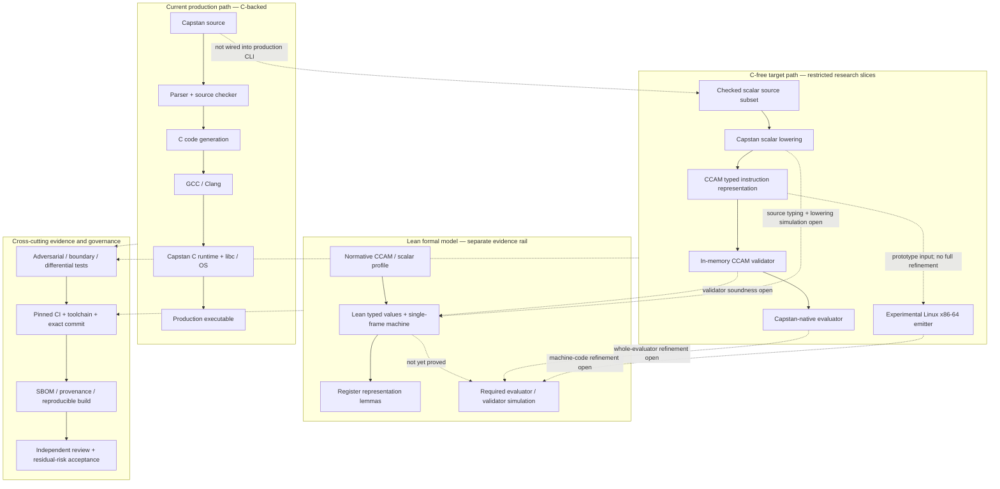

# Capstan execution assurance architecture

**Baseline:** 26 November 2026 source snapshot; exact freshness baseline is recorded in `execution-boundaries.json`  
**Disposition:** architecture and obligation map; not a system-level verification claim.

This is the operational view of the assurance boundary. The machine-readable
companion is [`execution-boundaries.json`](execution-boundaries.json), checked by
`scripts/assurance-validate.py` in CI. The formal obligation details remain in
[the formal verification matrix](FORMAL-VERIFICATION-MATRIX.md) and
[the C-free type-safety plan](C-FREE-TYPE-SAFETY.md).

## 1. Two execution paths — do not conflate them

Solid arrows represent an implemented execution path or a formal dependency
within the stated restricted scope. Dashed arrows represent a desired connection,
a prototype-only route, or an unproved correspondence. The diagram intentionally
shows the formal model as a separate rail: a Lean theorem does not automatically
prove a parser, validator, Capstan evaluator, native emitter or production binary.

## 2. Boundary register

The companion JSON records each interface as a separately reviewable obligation.
Its fields distinguish:

- **implementation status** — absent, specified, prototype, restricted or production;
- **formal status** — unproved, model-only, partial or proved;
- **implementation refinement** — whether an explicit theorem connects the
  implementation at that boundary to the formal semantics;
- **artifacts** — source and specification paths whose changes invalidate review;
- **open obligations** — concrete evidence still required.

A boundary may be marked `proved` only when the record says
`implementation_refinement: true`. The validator enforces this consistency rule.
It does not check that the theorem is correct, inspect its hypotheses or decide
whether the relation is adequate; that remains a substantive review task.

## 3. Current boundary assessment

| Boundary | Current evidence | Missing link |
|---|---|---|
| Source parser/checker → typed scalar source | Production checker enforces explicit finite bounds on direct input builtins; a restricted checked scalar lowering workstream exists | Formal source typing judgement, checker soundness, production CLI integration |
| Typed scalar source → CCAM | `verification/ccam_lowering.cap` implements a restricted subset and rejects unsupported constructs | Source-to-CCAM simulation and exact semantic preservation |
| CCAM decoding / validation | Capstan-native in-memory validators exist for restricted subsets | Closed-schema JSON decoder, duplicate-key rejection, normative whole-program validator, validator soundness |
| CCAM evaluator | Single-frame and bounded multi-function executable slices exist in Capstan | One integrated normative machine; whole-machine Lean semantics and evaluator refinement |
| Lean register model → concrete evaluator | Runtime/native register bridge lemmas cover selected representation operations | State relation established and preserved by every concrete instruction transition |
| CCAM → native machine code | Linux x86-64 scalar emitter prototype | Full instruction/effect/resource coverage, differential conformance, machine-code simulation and supported ABI matrix |
| Runtime → OS/platform | Existing C runtime and platform adapters are production dependencies | C-free runtime implementation, explicit host capability boundary and per-platform refinement/evidence |
| Bootstrap/build → release artifact | Existing bootstrap, CI and supply-chain controls | Independently reproducible C-free bootstrap and complete provenance/TCB reduction |

### Direct external-input contract

The source/runtime boundary now requires an explicit finite caller-supplied bound for direct input operations, including \`args\`, \`read_file\`, \`read_line\`, \`read_bytes\`, \`secret_env\` and the workspace file reader. The checker enforces arity and bound types; generated runtime and stage-0 paths enforce the corresponding byte/count limits before allocation or consumption. The normative details and exact limits are in [the bounded-input contract](../architecture/BOUNDED-INPUT-CONTRACT.md).

These are resource bounds, not timeouts. In particular, \`read_file\` may still block on a live FIFO or device; the contract does not claim a wall-clock bound or cancellation guarantee. Input remains \`Tainted\` unless separately validated. This work strengthens the existing C-backed production path; it does not establish a C-free runtime or formal source-checker proof.

## 4. Required proof composition

The C-free scalar type-safety theorem must be composed from explicit lemmas,
not inferred from a sequence of passing tests:

1. **Front-end soundness:** every accepted source term in the scalar profile has
   the formal source type assigned by the checker.
2. **Lowering preservation:** evaluation of an accepted source term corresponds
   to execution of its emitted CCAM program, preserving values, traps, evaluation
   order, control flow and resource accounting.
3. **Decoder/validator soundness:** every admitted encoded program decodes to the
   exact validated CCAM object; malformed, ambiguous and out-of-profile inputs
   are rejected before execution.
4. **Machine preservation and progress-or-trap:** every reachable validated
   machine state preserves register/frame invariants and takes a defined step,
   returns, or traps explicitly.
5. **Concrete evaluator refinement:** every concrete dispatch simulates the
   corresponding abstract transition, including failure atomicity, trap payloads,
   PC and fuel accounting.
6. **Native refinement:** generated machine-code execution preserves the CCAM
   observable trace and resource/effect contract under a stated ABI/platform model.
7. **Runtime/platform boundary:** all remaining host calls are mediated by a
   narrow, specified interface with explicit authority, memory and failure rules.

The system theorem is conditional on the conjunction of these links and their
assumptions. If one link is missing, the claim stops at the last established
boundary.

## 5. Immediate implementation order

The current high-value sequence is:

1. Freeze a precise CCAM-SF-P profile and reconcile its entry, terminality, trap
   and fuel rules with the normative CCAM document.
2. Complete the shared concrete/Lean vector harness: identical inputs, exact PC
   traces, register state, terminal result, trap payload and step count.
3. Prove initial-state correspondence and one-step simulation for every in-profile
   instruction, then prove the validator-to-machine construction relation.
4. Extend the proof to the multi-frame machine and the actual call/return protocol.
5. Prove source checker and scalar lowering soundness against the same semantics.
6. Treat native code generation as a subsequent refinement, never as a second
   independent semantics.
7. Retire generated C and the C runtime only after the C-free compiler, runtime,
   bootstrap and supported platform matrix pass their own gates.

These are engineering gates, not estimates or claims that the work is complete.
