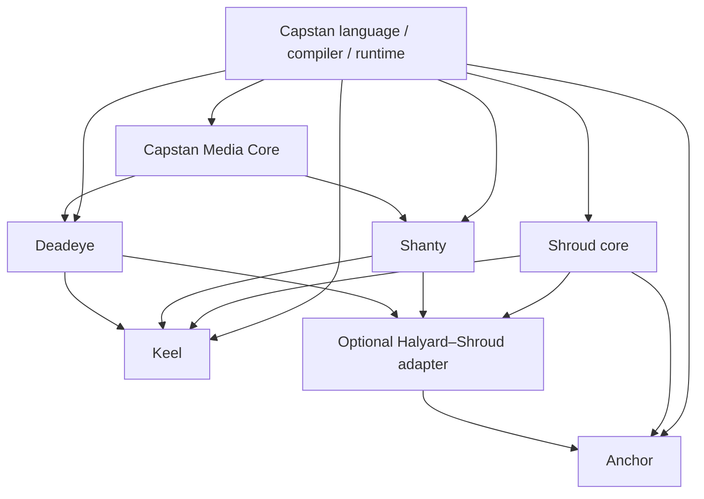

# Halyard — detailed media architecture

> **Status: Specified / initial implementation programme — 2026-11-25**
>
> This document is the detailed architectural specification for Halyard: Capstan Media Core,
> Shanty and Deadeye. The governing architecture identity and integration map are in
> [HALYARD.md](HALYARD.md). It is not a claim that codecs, playback, recording, platform backends or
> security properties are already implemented. Every capability must carry an explicit
> implementation and assurance status.

## 1. Halyard component definition

Halyard is the media architecture of the Capstan ecosystem. Its implementation comprises:

- **Capstan Media Core** owns shared media primitives, format/container infrastructure,
  resource accounting, clocks, scheduling contracts and codec registration.
- **Shanty** is the audio engine: ingest, decode, encode, playback, capture, mixing,
  resampling, synthesis, spatialisation and audio processing.
- **Deadeye** is the video engine: image and video ingest, demux/decode, encode, frame
  scheduling, presentation, composition, colour management, effects and streaming.

Shanty and Deadeye are independently usable products. Neither may require the other.
They share versioned Core contracts and may be composed into synchronised audiovisual
pipelines. Shroud core remains media-independent. An optional, separately versioned
Halyard–Shroud adapter consumes Shanty/Deadeye presentation APIs together with Shroud
rendering/input APIs; this integration package is not a dependency of either media
engine. Keel may consume and orchestrate media graphs and application lifecycles but
must not duplicate codec semantics.

## 1.1 Current implementation snapshot

The first MC1 prototype is on the Halyard working branch:

- `lib/halyard/core.cap`: in-memory bounded byte source and sink, sequential aggregate ledger, and rational timestamp rescaling;
- Capstan `test` declarations in `lib/halyard/core.cap`: source, sink, ledger and timebase boundary regressions;
- `lib/halyard/shanty.cap`: bounded RIFF/WAVE integer-PCM parsing and offline 8/16/24/32-bit sample decoding, with eleven colocated Capstan tests.
- `lib/halyard/deadeye.cap`: strict uncompressed 24/32-bit BMP decoding into bounded RGBA frames, with eight colocated Capstan tests.

The Halyard implementation and its test logic are authored in Capstan. No Halyard-specific
shell, Python, C, C++ or other-language implementation or test source is added.

The Shanty first slice accepts RIFF/WAVE PCM format tag 1, 1–8 channels, 1–384 kHz,
8/16/24/32-bit integer samples, at most 8 MiB per input and 1024 chunks. It skips
unknown chunks with RIFF padding and rejects duplicate format/data chunks, malformed
alignment and trailing-size mismatches. It does not provide device playback/capture,
compressed codecs, WAVE extensible or floating-point PCM. Budgeted entry points charge bounded parser work, retained PCM payload and decoded sample units; the live ledger does not yet own every sample allocation.

The Deadeye first slice accepts a strict 40-byte Windows BITMAPINFOHEADER/BI_RGB profile:
24-bit BGR or 32-bit BGRx, top-down or bottom-up, canonical pixel offset, 16 MiB input,
2,097,152-pixel and 8,192-side limits. It emits opaque RGBA8 and rejects palettes,
bitfields, RLE, other DIB headers and trailing data. It is not a general BMP decoder or a
colour-managed image pipeline.

This is not an MC1 gate exit. Publicly mutable struct fields prevent an enforced opaque
ownership boundary; the live ledger and cumulative budget are sequential-only and publicly mutable; and
allocation admission still cannot guarantee rollback after allocator exhaustion because the runtime lacks a recoverable allocation-result contract. The extended live vector has twelve dimensions, but logical allocation-object slots are not allocator-exact memory accounting. Managed source and sink paths now charge retained payload and allocation-object slots, including copy-on-commit peak overlap; parser/sample/frame allocations are not yet all tied to live leases. Budgeted Shanty/Deadeye entry points charge cumulative input, work, output and decoded-unit budgets, but legacy unbudgeted APIs remain callable. Cancellation, lifetime-bound opaque ownership, full parser/worker resource coupling and clock/discontinuity semantics remain outstanding. Rational timestamp rescaling has an initial Capstan-native implementation with checked integer arithmetic and explicit rounding, but no complete clock model.
See [CORE-PRIMITIVES.md](CORE-PRIMITIVES.md) and follow-up issue #293. Exact-head CI is
pending and no test pass is asserted until its result is observed.

## 2. Dependency direction

The graph below uses **provider → consumer** arrows. Halyard is the media architecture
umbrella; it is not a dependency node or a fourth implementation library.

Core does not depend on Shanty, Deadeye, Shroud, Anchor or Keel. Shanty and Deadeye
depend on Core and retain domain-specific types and schedulers; neither depends on the
other. Shroud core remains media-independent. The optional Halyard–Shroud adapter
depends on Shroud and the relevant media presentation APIs; neither media engine depends
on Shroud. Keel and Anchor consume the APIs they need. The dependency graph is acyclic.

## 3. Architectural layers

### 3.1 Core primitives

The first normative contracts are specified in [CORE-PRIMITIVES.md](CORE-PRIMITIVES.md) and include:

- bounded byte sources and sinks, with explicit ownership and cancellation;
- immutable input spans and explicit mutable output reservations;
- checked arithmetic for offsets, lengths, strides, plane sizes and timestamp conversion;
- rational time bases and integer timestamp arithmetic (no floating-point clock authority);
- explicit stream, track, packet, frame and sample descriptors;
- aggregate resource budgets, not merely per-object maximums;
- structured errors with stable error classes and no secret-bearing payloads;
- deterministic format/codec registration and versioned capability discovery;
- cancellation, deadlines and bounded cleanup obligations;
- provenance for every implementation, dependency, licence and assurance claim.

A parser must not allocate from an untrusted declared length before checking it against
both local and aggregate budgets. All size arithmetic uses checked operations or
subtraction-form admission checks. Resource reservations are atomic: failure leaves
observable state unchanged.

### 3.2 Format model

Keep these concepts separate:

1. **Container** — packages tracks, timestamps and metadata (for example Matroska, MP4,
   WAV or MPEG-TS).
2. **Codec** — transforms elementary audio/video/image data (for example FLAC, Opus,
   AVC or AV1).
3. **Profile, level and configuration** — constrain a codec bitstream.
4. **Transport or manifest** — delivers media over a network (for example HLS or DASH).
5. **Ancillary data** — subtitles, captions, chapters, timecode, metadata and attachments.

Container recognition does not imply support for every codec it can carry. Every
compatibility claim must identify container, codec, profile/level, bit depth, chroma,
channel layout, bitstream features, decode/encode direction and tested version.

MIDI is event data, not a waveform codec; it requires a synthesiser and instrument bank.
Encrypted/DRM-protected content is not a generic codec capability and is excluded unless
there is a lawful, separately reviewed integration.

### 3.3 Codec execution boundary

Every parser, demuxer, decoder, encoder and postprocessor is treated as a separately
reviewable component. The registry records:

- stable identifier and version;
- supported containers/codecs/profiles and operation directions;
- implementation origin, source revision, build flags and platform support;
- licence, patent and redistribution review state;
- memory, CPU, thread, frame, dimension, packet and output limits;
- isolation mode and capability set;
- conformance corpus, fuzz corpus and differential oracle;
- known limitations and assurance status.

Untrusted third-party or complex codec code runs behind a restricted worker boundary
where the platform supports it. No codec receives ambient filesystem, network, process,
device or secret access. A worker receives only bounded input and explicit output
reservations. Worker death, timeout, malformed output or budget exhaustion is a typed
failure, never permission to continue with partially trusted state.

**Implementation-origin rule: all media implementation code is written from scratch in
Capstan.** This applies to Media Core, Shanty, Deadeye, every parser, demuxer, bitstream
reader, decoder, encoder, resampler, synthesiser, mixer, filter, colour transform, image
operation, protocol/manifest handler and codec worker. No external multimedia framework,
codec library, parser library, or copied/vendored implementation may sit underneath or
inside these products. In particular, FFmpeg, GStreamer, libav and third-party codec
implementations are not runtime dependencies and are not code-generation backends.

External specifications, standards, published research, advisories, test vectors and
independently produced test corpora may be consulted under their applicable terms.
Independent implementations may be used as differential-test oracles in isolated
development/test infrastructure, but their code must not be linked, copied or shipped
as part of Capstan Media. Every implementation must have recorded authorship and source
provenance. Standards-essential patent and licence questions still require review.

The Capstan language/compiler/runtime path is the implementation target. The programme
must advance in step with Capstan's C-free native execution and self-hosting work: no
generated-C media implementation, no C codec shim, and no hidden C/C++ multimedia
runtime. Until the C-free path is actually available and evidenced, any unavoidable
host-runtime boundary must be explicitly identified as a temporary trusted-computing-base
dependency, not misrepresented as a completed native guarantee.

Building from scratch is not a security proof. Each implementation must earn its
assurance through typed contracts, checked arithmetic, bounded resource use, adversarial
testing, fuzzing, independent review and—where the research stream can establish it—
machine-checked properties and implementation-refinement evidence.

### 3.4 Pipeline graph

Media processing is represented as a typed directed graph:

- nodes declare input/output media types, formats, clock domains and resource costs;
- edges declare ownership, queue capacity, backpressure and cancellation behaviour;
- graph planning selects conversions and hardware/software paths;
- the planner may fuse compatible stages and avoid intermediate copies;
- every conversion is explicit and testable;
- software reference paths remain available for correctness comparison;
- hardware acceleration is optional and never silently changes output semantics.

A graph must be rejected before execution if its declared bounds cannot be reserved.
Runtime scheduling must preserve bounded queues and propagate backpressure. No unbounded
producer queue is permitted.

### 3.5 Real-time audio and audiovisual synchronisation

Shanty's audio callback path must not block, allocate unpredictably, perform filesystem
or network I/O, acquire contended locks, or invoke unbounded user callbacks. Control
operations and graph reconfiguration happen outside the device callback and are applied
at defined boundaries.

Deadeye uses rational presentation timestamps and explicit frame durations. Variable
frame rate is represented directly; it must not be coerced into a constant-rate model.

A/V synchronisation uses an explicit master-clock policy (audio, video or external clock),
bounded drift correction and observable discontinuity handling. Timestamp wrap, seek,
pause, resync, discontinuity and clock-source change semantics are specified and tested.
Wall-clock floating point is never the normative timing representation.

## 4. Security and assurance contract

Threats include malformed/truncated media, integer overflow, parser confusion, decompression
bombs, oversized dimensions, excessive frame/sample counts, pathological metadata,
deep nesting, recursive references, hostile playlists, malicious subtitles, codec
memory corruption, worker compromise, device faults and resource exhaustion.

Mandatory invariants:

1. Validate lengths, offsets, counts, dimensions, strides and time bases before use.
2. Bound aggregate bytes, allocations, decoded samples, pixels, frames, tracks, metadata,
   nesting, CPU work, threads, queue depth and wall-clock time.
3. Charge work before expensive operations; reject without partial state mutation.
4. Treat metadata, filenames, tags, subtitles, manifests and embedded artwork as untrusted.
5. Never execute scripts, macros, attachments, external references or playlist commands
   implicitly.
6. Deny network and filesystem access by default; grant narrow capabilities per operation.
7. Do not expose device handles, host pointers or secrets to codec plugins/workers.
8. Validate worker output independently before it enters trusted graphs.
9. Fuzz every parser and codec boundary; retain minimized regressions permanently.
10. Make failure deterministic, bounded and recoverable; no silent truncation or fallback
    that changes fidelity without an explicit policy.
11. Pin dependencies and build configurations; produce SBOM, provenance and licence data.
12. Distinguish tested, fuzzed, model-checked, formally verified and implementation-refined
    properties. A proof of a parser model is not proof of its implementation absent a
    correspondence argument.

The media implementation must be authored in Capstan and must not introduce C/C++ media
code or generated-C output. The current compiler/runtime execution path may still have
C-backed components; these remain explicit trusted-computing-base dependencies until
the C-free native compiler/runtime path is implemented, bootstrapped and independently
verified. Writing a decoder in Capstan does not by itself establish end-to-end memory
safety. Media milestones must track and consume the C-free/CCAM assurance gates rather
than silently treating them as complete.

## 5. Shanty scope

Initial vertical slice: bounded byte source -> RIFF/WAVE parser -> PCM sample frames ->
validated audio buffer -> deterministic offline render/mix -> output sink.

Initial required PCM support:
- little-endian integer PCM 8/16/24/32-bit;
- IEEE float PCM 32/64-bit only after bit-level conformance tests;
- mono and multichannel channel layouts with explicit channel order;
- sample-rate metadata and checked frame/byte arithmetic;
- RIFF chunk order variation, unknown chunk skipping under budget, padding and truncation;
- explicit rejection of unsupported encodings and malformed block alignment.

The first slice is an offline decoder and deterministic processing test, not a claim of
hardware playback. Device capture/playback follows only after platform I/O capabilities
and callback contracts are reviewed.

Subsequent capabilities: FLAC, ALAC, WavPack, MP3, AAC, Vorbis, Opus, MIDI synthesis,
multitrack mixing, resampling, effects, spatial audio, broadcast formats, streaming and
professional production workflows.

## 6. Deadeye scope

Initial vertical slice: bounded image source -> image/container identification -> safe
raster decode -> validated frame descriptor -> deterministic frame transform/output.

The first image formats should be selected by implementation and licensing review; PNG
is a useful first target because Shroud S0 already has a PNG-oriented headless rendering
and parsing surface, but Shroud's existing PNG support must be audited before reuse. Do
not infer full PNG image-decoder support from Shroud's PNG output path.

Next: image sequences, still-image formats, container demux, video decode and frame
presentation. Video playback is not claimed until a codec, timestamp and platform
presentation path is implemented and tested.

Target codec families include AVC/H.264, HEVC, AV1, VP8/VP9, MPEG-1/2, Theora, ProRes
and DNxHR, subject to profile, licence, patent, platform and test-corpus review.
Containers include MP4/MOV, Matroska, WebM, AVI and MPEG-TS. Professional image
sequences include TIFF, DPX and OpenEXR. HDR, wide gamut, high frame rate, stereo/360°
and variable frame rate are first-class design concerns.

## 7. Compatibility policy

The ambition is the broadest practical compatibility catalogue, not an unqualified claim
to decode every format ever made. Undocumented, proprietary, encrypted, DRM-restricted,
damaged beyond recovery or hardware-dependent formats may be impossible or unlawful to
support. Compatibility is reported per exact feature tuple, not by container name alone.

A published matrix will classify each entry as:
- **Target** — desired, not implemented;
- **Specified** — contract exists;
- **Prototype** — experimental implementation;
- **Implemented** — code exists;
- **Tested** — declared corpus passes;
- **Fuzzed** — named fuzz campaign and corpus evidence;
- **Verified** — exact formal property and model are identified;
- **Refined** — implementation correspondence is evidenced;
- **Unsupported** — explicitly not supported, with reason.

Decode and encode support are separate. Hardware and software paths are separate. A codec
may not be labelled simply "supported" without these qualifiers.

## 8. Performance and quality programme

Benchmark against relevant established alternatives on identical hardware and input
corpora. Record compiler, dependency revisions, flags, CPU/GPU, operating system, power
mode, warm-up, repetitions, variance and raw results.

Measure at least:
- throughput (samples/s, frames/s, MiB/s);
- end-to-end latency and tail latency;
- peak and steady-state memory;
- allocations, copies and bytes moved;
- CPU utilisation, thread count and energy where measurable;
- startup, seek and recovery time;
- output fidelity using exact PCM comparisons or appropriate objective/perceptual
  metrics, with subjective tests for claims that require them.

Performance claims must never trade away conformance, determinism or declared security
limits. Compare both software reference and hardware-accelerated modes. Publish scripts,
input hashes and machine-readable results.

## 9. Research stream

The normative hypothesis register, literature anchors, experimental questions and
research governance are maintained in [RESEARCH-AGENDA.md](RESEARCH-AGENDA.md).
The active hypotheses are:

- **H1 / R8.1:** compositional resource semantics, reservation conservation and
  alias/lifetime accounting under nested and concurrent media workloads.
- **H2 / R8.2:** verified format descriptions and parser/serializer refinement for
  realistic media structures.
- **H3 / R8.3:** ownership-safe zero-copy with bounded leases and provable retention.
- **H4 / R8.4:** preflighted deterministic real-time audio execution and deadline bounds.
- **H5 / R8.5:** rational multi-clock A/V synchronisation and explicit discontinuities.
- **H6 / R8.6:** proof-preserving graph optimisation with explicit resource deltas.
- **H7 / R8.7:** format-aware differential and metamorphic fuzzing.
- **H8 / R8.8:** typed colour/HDR/scientific signal semantics and provenance.
- **H9 / R8.9:** contract-aware distributed graph execution (deferred until after MC3).

Each hypothesis requires a literature review, threat/assumption statement, experimental
protocol, named baselines, reproducible raw artefacts, independent reproduction and
explicit negative results. Research hypotheses are not product guarantees. A model proof
is not implementation refinement; benchmark improvements must not weaken correctness,
security, fidelity or declared resource limits.

## 10. Stage gates

| Gate | Deliverable | Exit criteria |
|---|---|---|
| MC0 | Architecture and threat model | Reviewed dependency graph, type/ownership model, resource ledger, format taxonomy, licence policy, research hypotheses |
| MC1 | Core byte/stream substrate | Checked offsets, bounded reads, ownership, cancellation, aggregate budgets and adversarial tests |
| SH0 | Shanty WAV/PCM offline slice | RIFF/WAVE parser, PCM vectors, malformed corpus, deterministic output and differential checks |
| DE0 | Deadeye image/frame slice | Selected safe image format, bounded decode, frame descriptors, malformed corpus and pixel oracle |
| MC2 | Codec worker boundary | Capability-minimal worker protocol, quotas, crash/timeout handling, output validation |
| SH1/DE1 | Playback/presentation foundations | Device/platform adapters with callback/clock contracts and integration tests |
| MC3 | Synchronised graph | A/V master-clock policy, VFR, drift correction, backpressure and seek/discontinuity tests |
| MC4 | Compatibility expansion | Versioned format matrix, per-feature test evidence and legal review |
| MC5 | Assurance and performance | Fuzz coverage, sanitizer evidence, model/proof obligations, reproducible benchmarks |
| MC6 | Scientific and professional media | DICOM/scientific formats, HDR, spatial audio, production and digital-twin integrations |

A gate is not passed by documentation or a successful build alone. Each exit criterion
must link to exact code, test, corpus, benchmark or proof evidence.

## 11. Initial pullable work

Work packages should remain small, independently reviewable and explicitly dependent:

- MEDIA-001: review architecture, naming, boundaries and threat model (MC0).
- MEDIA-002: define bounded byte-source/sink and ownership contract (MC1).
- MEDIA-003: define checked aggregate resource ledger and atomic reservation model (MC1).
- MEDIA-004: define rational timebase and timestamp arithmetic with conformance vectors (MC1).
- MEDIA-005: define format/codec registry schema and status vocabulary (MC0).
- SHANTY-001: audit existing language/runtime support and establish WAV/PCM fixture corpus.
- SHANTY-002: specify RIFF/WAVE chunk parser and malformed-input matrix.
- SHANTY-003: implement bounded RIFF/WAVE metadata parser after MEDIA-002/003.
- SHANTY-004: implement PCM sample conversion and exact vectors.
- DEADEYE-001: audit Shroud PNG code and distinguish PNG rendering from image decoding.
- DEADEYE-002: select first image decoder based on format, licence and security review.
- DEADEYE-003: define bounded image/frame descriptors and pixel-oracle corpus.
- MEDIA-006: define the native Capstan worker protocol and isolation threat model; workers
  execute first-party Capstan media implementations only.
- RESEARCH-MEDIA-001: literature review and reproducible protocol for aggregate resource accounting.

## 12. Non-goals and prohibitions

- No promise of literally every historical/proprietary format.
- No automatic network fetching, external-resource resolution or script execution.
- No implicit codec plugin loading from media files.
- No unbounded buffers, queues, recursion or worker creation.
- No silent decode fallback that changes colour, bit depth, channel layout or fidelity.
- No claiming Shroud's PNG output is a general image decoder.
- No treating Capstan source syntax as proof that current C-backed runtime boundaries are safe.
- No third-party media implementation dependencies, vendored codec code, copied parser
  code, generated-C media path or C/C++ media shim.
- No "fastest", "safest" or "best" market claims without reproducible comparative evidence.

## 13. Mandatory security assurance

The normative vulnerability accounting, root-cause threat catalogue, reproducer and regression protocol, continuous advisory reconciliation and release-blocking security gates are specified in [SECURITY-ASSURANCE.md](SECURITY-ASSURANCE.md). These requirements apply to Core, Shanty, Deadeye, all shipped codecs, parsers, protocol handlers, platform adapters and transitive/build-time dependencies. Architecture review and implementation must not weaken these gates.
