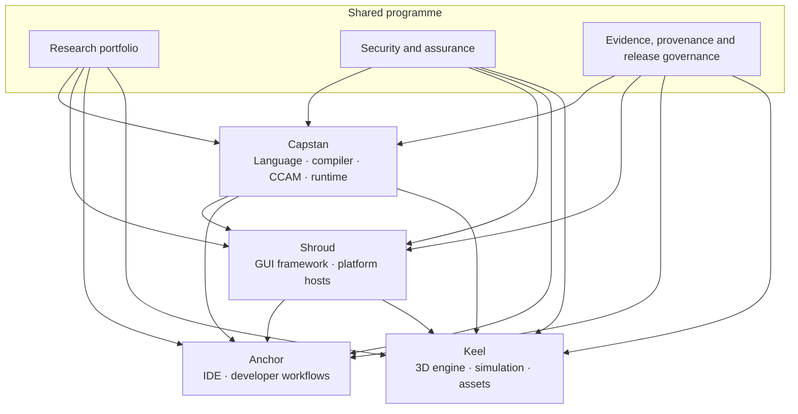

# Capstan ecosystem programme

**Status:** proposed programme baseline for review  
**Revision date:** 2026-11-25  
**Scope:** Capstan, Shroud, Anchor, Keel, Shanty and Deadeye, with shared Capstan Media Core

## Purpose

Coordinate six independently deliverable products/components through shared semantic foundations, research and assurance. Capstan Media Core is the shared substrate for the two media engines, not an independent product release. This programme is a governance and planning layer; it does not supersede product specifications, the research register, the formal-verification matrix or the v1 release scorecard.

The programme deliberately distinguishes implementation maturity from assurance maturity. A merged change, green CI run, prototype, model proof or self-hosting result must not be promoted into a broader correctness or security claim without evidence for that claim.

## Product responsibilities

| Product | Owns | Does not own |
|---|---|---|
| **Capstan** | Language semantics, compiler, CCAM, validation/evaluation, native backends, runtime, standard library, bootstrap and compiler-facing services | GUI toolkit policy, IDE-specific semantics, 3D-engine policy |
| **Shroud** | Reusable GUI framework: layout, widgets, input, focus, text, rendering, export and narrow platform hosts | Language acceptance, compiler security policy, 3D scene/simulation semantics |
| **Anchor** | IDE, project/workspace UX, editor integration, diagnostics presentation, build/test/debug workflows and developer-facing orchestration | A second compiler, independent type checker, or alternative security-policy authority |
| **Keel** | 3D engine: scene model, geometry, assets, animation/simulation, rendering orchestration, GPU resource lifecycle and engine-specific APIs | A second GUI framework, language/compiler semantics, unrestricted platform/GPU trust |
| **Shanty** | Independent audio engine: ingest, decode/encode, playback/capture, mixing, resampling, synthesis, spatialisation and audio processing | Video engine, shared media primitives, GUI framework or a third-party multimedia runtime |
| **Deadeye** | Independent video/image engine: ingest, demux/decode, encode, frame scheduling, presentation, composition, colour management and streaming | Audio engine, shared media primitives, GUI framework or a third-party multimedia runtime |

**Capstan Media Core** is a shared architectural component, not a seventh product: it owns bounded byte streams, buffers, rational clocks/timebases, resource accounting, format/codec registry and worker contracts. Core must not depend on Shanty or Deadeye; both engines depend on Core and remain independently usable.

Shroud is a reusable framework. Anchor and Keel consume Shroud presentation APIs; Keel owns its 3D engine abstractions. Shanty and Deadeye consume Media Core and expose stable presentation surfaces/events to Shroud. Keel may orchestrate media graphs but must not duplicate codec semantics. Capstan provides the language/runtime substrate and compiler services. All media implementation code is authored from scratch in Capstan; external media frameworks and codec implementations are not runtime/build dependencies. Product boundaries are contractual; shared code does not imply shared ownership of semantics.

## Architecture

The arrows represent architectural dependencies, not a serial release schedule. Product teams may progress in parallel against versioned contracts and mocks. No cycle is permitted: the compiler must not depend on Shroud, Anchor, Keel or Media; Media Core must not depend on Shanty/Deadeye; Shanty and Deadeye must not depend on each other; Anchor must consume compiler services rather than reimplement compiler rules. Shroud owns presentation adapters, not codecs. Keel may orchestrate media graphs but does not own media format semantics.

## Programme milestones

| ID | Milestone | Exit outcome |
|---|---|---|
| M0 | Programme control | Product ownership, dependency map, work board, risk register and evidence conventions agreed |
| M1 | Semantic foundation | Normative language/CCAM contracts and conformance corpus stable for the supported profile |
| M2 | Verified execution core | Whole-program validation/evaluation and implementation-linked proof obligations advanced with explicit boundaries |
| M3 | Native and C-free execution | Native backend and bootstrap stages reproducible; no unsupported claim of full C-free runtime |
| M4 | Runtime and security assurance | Runtime, memory, authority, concurrency, crypto and input/resource boundaries have scoped evidence |
| M5 | Shroud framework | GUI contracts, rendering/resource bounds, input/focus, text, platform hosts and accessibility conformance |
| M6 | Anchor IDE | IDE workflows consume canonical Capstan services and remain isolated from untrusted workspaces/projects |
| M7 | Keel engine | Bounded asset/scene pipeline, deterministic core, rendering/GPU lifecycle contracts and vertical slice |
| M8 | Capstan Media Core | Bounded streams/buffers, rational timebases, aggregate resource ledger, format registry and worker contract |
| M9 | Shanty audio engine | WAV/PCM offline slice, deterministic processing, then independently gated playback/capture and codec expansion |
| M10 | Deadeye video/image engine | Selected bounded image/frame slice, then demux/decode/encode and presentation expansion |
| M11 | Cross-product integration | Shroud presentation adapters, Keel media orchestration, Anchor workflows and synchronised A/V interfaces |
| M12 | Research validation | Research claims are falsifiable, reproducible, independently reviewable and publication-scoped |
| M13 | Product release qualification | Each product independently satisfies its release gates; ecosystem compatibility is demonstrated |

Milestones are outcomes, not calendar promises. A milestone may contain several independently pullable work packages.

## Shared stage gates

- **G0 — Ready:** problem, owner, scope, dependencies, threat assumptions and acceptance evidence are defined.
- **G1 — Specified:** normative contract, failure behaviour, resource limits and compatibility rules are reviewed.
- **G2 — Implemented:** implementation and focused regression tests exist at an exact commit.
- **G3 — Verified:** conformance, adversarial/property/fuzz tests and relevant formal obligations pass; limitations are recorded.
- **G4 — Independently assessed:** reviewer not responsible for the implementation examines evidence and unresolved risks.
- **G5 — Accepted:** product owner accepts the exact revision and residual risks; release claims are updated.

A gate may be PASS, CONDITIONAL PASS or FAIL. UNKNOWN is never PASS. A conditional pass must identify the exact limitation, owner, expiry/review date and prohibited claims.

## Engineering and assurance are separate axes

Record both:
- **Engineering maturity E0–E5:** proposed, specified, prototype, integrated, production-qualified, maintained.
- **Assurance maturity A0–A5:** unassessed, scoped, tested, adversarially evaluated, formally/independently supported, release-assessed.

Never infer A-level from E-level. For example, an integrated evaluator can remain at low assurance maturity until whole-program conformance and implementation correspondence are established.

## Shared research portfolio

1. **Semantics and formal methods:** CCAM semantics, compiler correctness, refinement, proof-carrying/evidence-carrying execution.
2. **Memory and resource safety:** allocator/GC invariants, bounded CPU/memory/stack/I/O, GPU resource lifetime.
3. **Security architecture:** capabilities, information flow, typed provenance, isolation, hostile-input handling and supply chain.
4. **Determinism and reproducibility:** execution, rendering, simulation, builds, bootstrap and replay.
5. **Empirical assurance:** vulnerability evidence, comparative evaluation, adversarial testing and independent replication.

Research questions are shared; each work package has one accountable product owner and explicit cross-product consumers. The research register remains authoritative for paper maturity and publication claims.

## Governance rules

1. Every claim is tied to an exact commit, platform, configuration and evidence artefact.
2. No evidence, no gate promotion. Missing evidence is UNKNOWN.
3. Product specs own product semantics; shared programme docs own coordination only.
4. No hidden C, compiler, OS, GPU-driver or toolchain dependency in a C-free/security claim.
5. Every worker card is independently reviewable and has one principal deliverable.
6. Cross-product work names the contract provider and consumer; no implicit API assumptions.
7. Research outcomes, including negative results and limitations, are deliverables.
8. Existing issues and PRs are mapped before duplicates are created. An open PR is not assumed to satisfy its issue until reviewed and merged.

## Authoritative documents

- [Design map](../DESIGN-MAP.md)
- [CCAM specification](../architecture/CCAM.md)
- [Research register](../research/RESEARCH-REGISTER.md)
- [Formal verification matrix](../assurance/FORMAL-VERIFICATION-MATRIX.md)
- [V1 release scorecard](../assurance/V1-RELEASE-SCORECARD.md)
- [Work board](WORK-BOARD.md)
- [Stage gates](STAGE-GATES.md)
- [Media architecture proposal](../media/ARCHITECTURE.md)
- [Media format catalogue](../media/FORMAT-CATALOGUE.md)
- [Media security assurance](../media/SECURITY-ASSURANCE.md)
